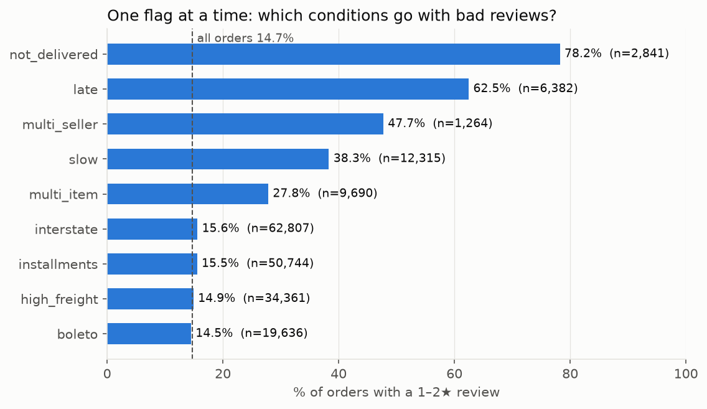
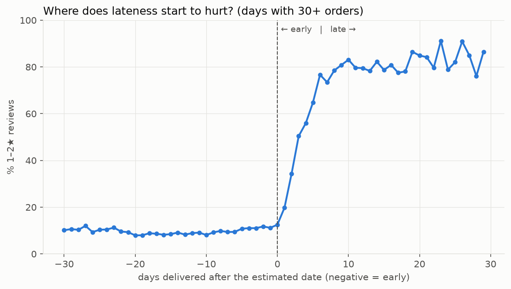
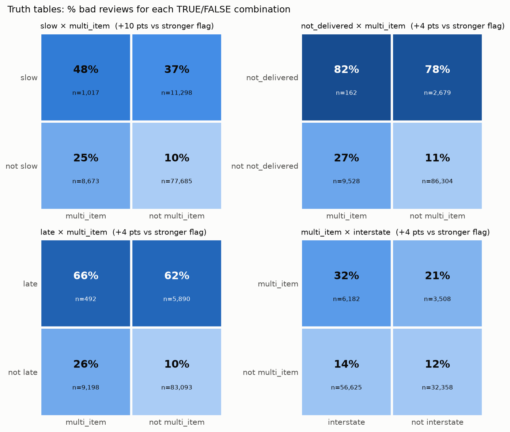
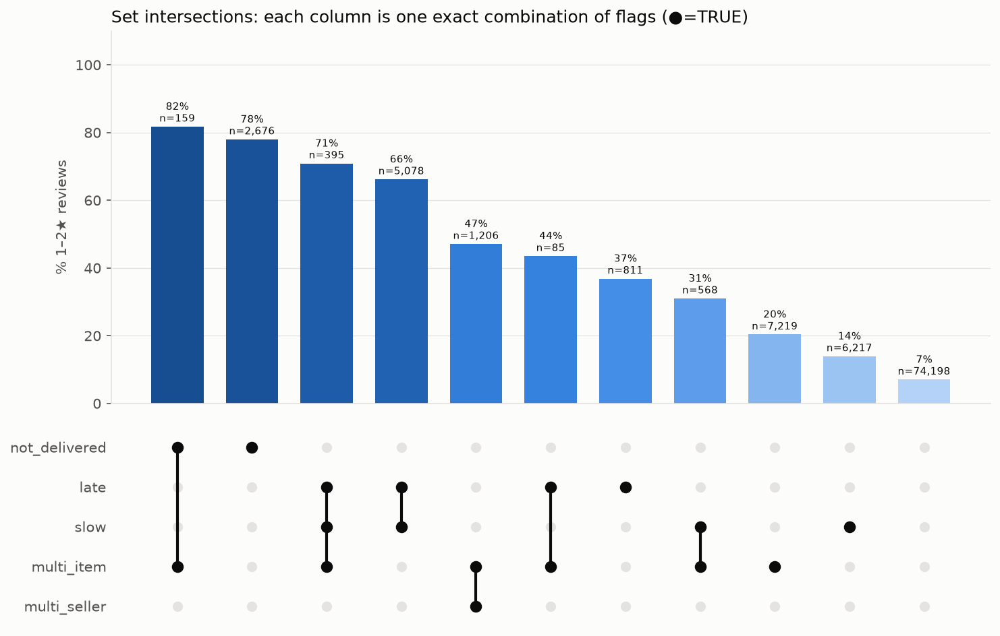
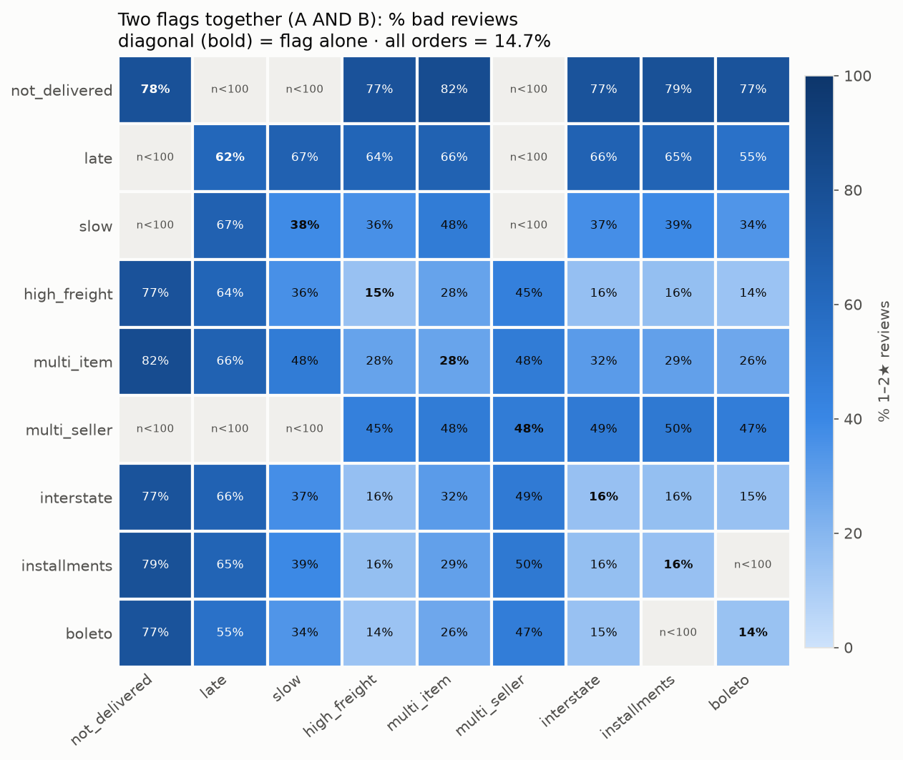
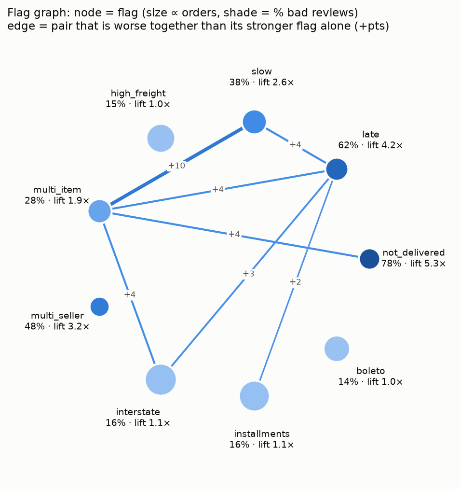

# Engagement Notes: Olist Revenue Growth

Working notes for the fde-agent engagement. They record how I'm thinking: what I'm asking,
what I've found in the data, and which ideas I'm testing. Every result here is measured
against a baseline.

**Client:** Olist (Brazilian e-commerce marketplace) · **Data:** public Kaggle datasets, 2016–2018
**Question:** Where does Olist's next revenue growth come from?

---

## Contents

1. [Revenue levers](#1-revenue-levers)
2. [Data inventory](#2-data-inventory)
3. [Data quality log](#3-data-quality-log)
4. [Baseline](#4-baseline)
5. [Exploration: what goes with bad reviews](#5-exploration-what-goes-with-bad-reviews)
6. [Hypothesis log](#6-hypothesis-log)
7. [Next steps](#7-next-steps)

---

## 1. Revenue levers

| # | Lever | Questions I'm asking | Tables |
|---|---|---|---|
| L1 | **More sellers** | Which seller leads turn into deals? What do closed-deal sellers have in common? | `marketing_qualified_leads`, `closed_deals`, `sellers` |
| L2 | **More orders** | Do customers come back? When they do, what do they buy and from whom? Is one big seller pulling customers in, and if so, what is that seller doing? | `customers` (`customer_unique_id`), `orders`, `order_items`, `sellers`, `products` |
| L3 | **Bigger orders** | What is the average order value (AOV)? How much does a customer spend per purchase? How do categories and installments affect it? | `order_items`, `payments`, `products` |
| L4 | **Fewer lost customers** | Does late delivery cause bad reviews? Do late deliveries lead to fewer repeat buyers? Which words show up in reviews below five stars (weighted 1★ = most, 4★ = least)? | `orders` (dates), `order_reviews`, `customers` |

**The levers interact.** A fix for one lever can hurt another. Example: fining sellers (L4)
could drive sellers away (L1). Check every solution against all four.

---

## 2. Data inventory

The data comes as two separate datasets that connect only through **sellers**:

```
 MARKETING FUNNEL (acquiring sellers)          MARKETPLACE (sellers selling to customers)
 ────────────────────────────────────          ──────────────────────────────────────────
 marketing_qualified_leads  (8,000)            customers (99,441) ──┐
        │ mql_id                                                    │ customer_id
        ▼                                                           ▼
 closed_deals  (842) ── seller_id ──────────▶ sellers (3,095)    orders (99,441)
                                                  │ seller_id      │ order_id
                                                  ▼                ▼
                                            order_items (112,650) ◀┘──▶ payments (103,886)
                                                  │ product_id     └──▶ reviews (~99k)
                                                  ▼
                                            products (32,951) ──▶ category_translation (70)
                                     (geolocation: 1M rows, joins on zip prefix, optional)
```

Raw CSVs live in `data/raw/` (gitignored). See the README for how to download them.

---

## 3. Data quality log

| # | Issue | Impact | Handling |
|---|---|---|---|
| DQ1 | `customer_id` is a **new ID for every order**, not one per person | Counting repeat buyers by `customer_id` gives 0% | Use `customer_unique_id` for anything about people |
| DQ2 | `wc -l` counts ~104k review rows, but there are ~99k reviews | Line counts overstate the data | Review comments contain line breaks. Trust pandas' row count, not `wc -l`. |
| DQ3 | `product_category_name_translation.csv` starts with an invisible BOM character | The first column name won't match | Read with `encoding="utf-8-sig"` |
| DQ4 | Revenue can be measured two ways | `order_items` and `payments` totals don't agree exactly | Revenue = `price` + `freight_value` from `order_items`. Payments include installment amounts. *(record in an ADR)* |
| DQ5 | Not every order is `delivered`: **2,963 of 99,441 (2.98%)** ([E1](evidence/E1-order-status.md)) | Undelivered orders aren't real revenue | Baseline counts `delivered` orders only. This also led to [H1](#h1-failed-first-order--customer-doesnt-return). |

---

## 4. Baseline

The "before" numbers. Every hypothesis is sized against them. Delivered orders only (DQ5).

| Metric | Value | Source |
|---|---|---|
| Total revenue | **R$ 15,419,773.75** | [E2](evidence/E2-baseline.md) |
| Delivered orders | **96,478** | [E2](evidence/E2-baseline.md) |
| Average order value | **R$ 159.83** | [E2](evidence/E2-baseline.md) |

Freight is R$ 2.2M of that revenue (14%). Item price alone is R$ 13.2M. Both counts include
freight, per DQ4.

---

## 5. Exploration: what goes with bad reviews

**Method.** I built one processed table with a row per reviewed order (98,673 orders) and a
True/False column for each condition (a *flag*). The *effect* is a 1–2★ review, which
happens on 14.7% of orders. Then I compared flags one at a time, in pairs (truth tables),
in exact combinations (set intersections), and as a graph.
Code: `src/fde_agent/processed.py` (flag rules), `src/fde_agent/figures.py` (charts).
Regenerate with `uv run python -m fde_agent.figures`.

| Flag | Rule |
|---|---|
| `not_delivered` | order_status is not `delivered` |
| `late` | delivered after the estimated date |
| `slow` | purchase → delivery took 21+ days |
| `high_freight` | freight is 30%+ of item price |
| `multi_item` / `multi_seller` | 2+ items / 2+ sellers in the order |
| `interstate` | a seller is in a different state than the customer |
| `installments` / `boleto` | paid in 2+ installments / paid by bank slip |

### What I see

**1. Delivery problems dominate.** Not delivered: 78% bad reviews. Late: 62%. Slow: 38%.
Payment method, freight share and interstate shipping barely move it (14–16%, about the
same as all orders).



**2. Lateness is a cliff, not a slope.** Early orders sit flat at ~10% bad reviews,
however early they arrive. Then the rate jumps to ~50% by 3 days late and ~80% by 9 days
late. The estimated date works like a promise: breaking it is what hurts, not slowness
itself.



**3. Multi-item orders hurt even when they're on time.** Multi-item orders that weren't
late still get 26% bad reviews, versus 10% for single-item on-time orders. Something other
than lateness is going on. My guess is split shipments: part of the order arrives and the
customer reviews before the rest does.



**4. The flags stack.** Late + slow + multi-item: 71% (n=395). The clean group with none of
the 5 delivery/order flags (n=74,198, 75% of orders) is at 7%.



<details>
<summary>Pair matrix and flag graph</summary>




</details>

**Caution.** All of this is correlation. Late orders may also be far-away, bulky, or from
weaker sellers. The logistic regression with controls (planned) is how I'll separate them.

### New hypotheses from this

- **H2: Missing the estimated delivery date causes bad reviews, which costs repeat
  revenue.** A cliff at day 0 points to *padding the estimate*, or warning customers before
  the date passes, as cheap fixes.
- **H3: Multi-item orders fail for a reason besides lateness**, likely split shipments.
  Check whether `review_creation_date` comes before the last item's delivery.

---

## 6. Hypothesis log

Numbers come from **evidence files** in [`docs/evidence/`](evidence/). Regenerate them with
`uv run python -m fde_agent.evidence`.

Each hypothesis follows the same loop:
**observe → hypothesize → test → size (R$) → kill criteria → solutions (net value) → pilot → decide.**

### H1: Failed first order → customer doesn't return

**Status:** 🟡 Open, not yet tested · **Lever:** L4 Fewer lost customers (also L2)

**Observation.** Some orders were never delivered: 96,478 of 99,441 were delivered,
which leaves **2,963 (2.98%)** in another status.
→ Evidence: [E1: order status breakdown](evidence/E1-order-status.md)

Not all of those 2,963 are failures. `shipped` (1,107) may be in transit when the data ends.
The clearest failures are `canceled` (625) and `unavailable` (609). This feeds the first
trap below.

**Hypothesis.** Customers whose order didn't arrive are less likely to come back. If they had
received it, more of them would have returned, and Olist lost that future revenue.

**Test design**

```
customers (by customer_unique_id)
   │ split by: was their FIRST order delivered?
   ├── yes ──▶ repeat rate = A%
   └── no  ──▶ repeat rate = B%
                 gap = A − B
```

**Sizing**

```
potential gain = (# failed-first-order customers) × (A − B) × (avg spend of a returning customer)
```

**Traps to handle before I trust the number**

- **Which statuses count as failed?** "Not delivered" covers `canceled`, `unavailable`,
  `shipped` and others. `shipped` may just mean in transit when the data ends.
- **Censoring.** Compare only customers with the same follow-up window, for example 6+ months
  after their first order.
- **Group size.** If the failed group is small, B% is noisy. Use a Wilson confidence interval.
- **Cause vs correlation.** Some cancels were the customer changing their mind, so the gap
  is only "associated with" a failed order until that's ruled out.

**Kill criteria.** Drop H1 if the gap A − B is under __ points, or if its confidence interval
includes 0.

**Solutions (if H1 holds)**, ranked by **net value = gain − cost**, not gain alone:

| Solution | Cost | Math to check | Risk |
|---|---|---|---|
| **Auto-detect lost orders:** flag when an order hasn't arrived X days after `order_estimated_delivery_date` | Low (the date already exists) | None. It makes the other two possible. | Picking X: too short gives false alarms |
| **Voucher or refund on the next order** | voucher value × redemption rate | Break-even: voucher < (A − B) × avg future spend | People who'd return anyway also redeem it |
| **Fine the seller,** unless they file a claim proving the cause was outside their control | Admin cost; brings in money | Fine revenue vs sellers who leave | Works against L1 (more sellers) |

**Recommendation (provisional).** Detect + voucher, if the voucher break-even holds.

**Pilot (A/B test).** This is the only way to show the voucher *causes* returns, not just correlates with them.

1. A random 50% of failed-order customers get a voucher. The other 50% get nothing.
2. Compare return rates over 6 months.
3. If the voucher group returns more, by more than the break-even, roll it out.

**Result:** _not yet run_

---

## 7. Next steps

- [x] `baseline()`: revenue, delivered orders, AOV → [section 4](#4-baseline)
- [x] Processed flag table + exploration charts → [section 5](#5-exploration-what-goes-with-bad-reviews)
- [ ] H1: `order_status` breakdown → repeat rate by first-order outcome → sizing
- [ ] H2: fit the threshold with scikit-learn (one-split tree), then logistic regression with controls
- [ ] H3: review date vs last item delivery for multi-item orders
- [ ] Repeat-purchase rate overall (L2)
- [ ] Seller revenue concentration: Lorenz curve + Gini (L3)
- [ ] Lead conversion by `origin` with confidence intervals (L1)

---

<details>
<summary>Template for new hypotheses</summary>

```markdown
### HN: <short claim>

**Status:** 🟡 Open · **Lever:** L_

**Observation.**
**Hypothesis.**
**Test design.**
**Sizing.**
**Traps.**
**Kill criteria.**
**Solutions** (cost · math · risk, ranked by net value)
**Recommendation.**
**Pilot.**
**Result.**
```

</details>
